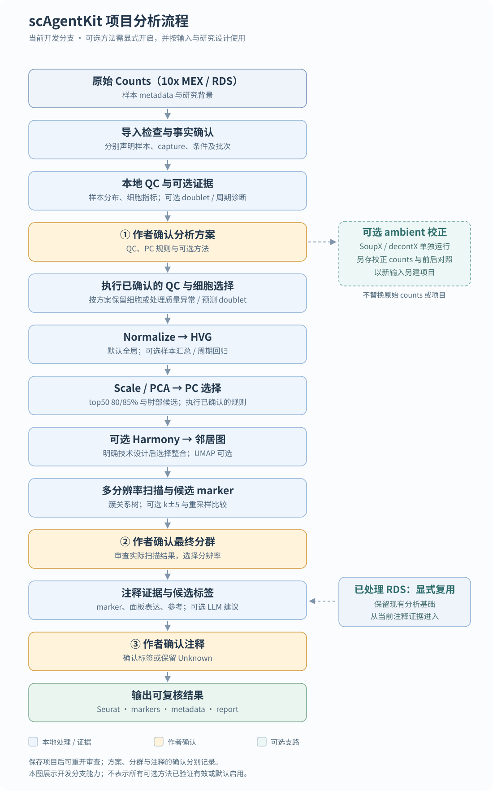

# scAgentKit

**English** · [简体中文](README.zh-CN.md)

scAgentKit guides researchers from single-cell counts and sample information
through QC, basic analysis, clustering and reviewed annotation. A saved project
contains a new Seurat object, marker tables, figures and your recorded decisions.

**Before 1.0, any version may break compatibility. No deprecation period is
guaranteed, and resuming a project across versions is unsupported.**

## Analysis workflow



[English diagram](docs/diagrams/project-analysis-flow.svg) · [中文流程图](docs/diagrams/project-analysis-flow.zh-CN.svg) · [Diagram source](docs/diagrams/generate_project_flow.py)

Version 0.8.0 pauses for three approvals: your analysis plan, the measured
clustering choice and the annotation proposal. Follow the steps below; the
[operator guide](docs/SCIENTIFIC_REVIEW_QUICKSTART.md) covers optional methods.
For historical v0.6.0, use its [matching protocol](docs/RELEASE_060_PROTOCOL.md).

## Installation

Requires R ≥ 4.2, Seurat ≥ 5 and Python ≥ 3.9 for the browser.
Browser resources are included in the R package.
Supported platforms: **macOS and Linux**. **Windows is unsupported** because the
local service and worker use [Unix `fcntl` file locks](https://docs.python.org/3/library/fcntl.html).

Download the [v0.8.0 archive](https://github.com/ChanghaoKan/scAgentKit/releases/download/v0.8.0/scAgentKit_0.8.0.tar.gz)
and checksum from the [Release](https://github.com/ChanghaoKan/scAgentKit/releases/tag/v0.8.0),
then verify the downloaded file:

```sh
curl -fL --retry 3 --connect-timeout 30 --max-time 1800 -o scAgentKit_0.8.0.tar.gz https://github.com/ChanghaoKan/scAgentKit/releases/download/v0.8.0/scAgentKit_0.8.0.tar.gz
curl -fL --retry 3 --connect-timeout 30 --max-time 1800 -o SHA256SUMS https://github.com/ChanghaoKan/scAgentKit/releases/download/v0.8.0/SHA256SUMS
shasum -a 256 -c SHA256SUMS  # macOS; on Linux use: sha256sum -c SHA256SUMS
```

Continue only if the checksum matches. In a fresh R session, run this from the
download directory to install the package and its required dependencies:

```r
options(timeout=max(1800, getOption("timeout", 60)))
lib <- path.expand("~/R/scagentkit-library")
dir.create(lib, recursive=TRUE, showWarnings=FALSE)
.libPaths(c(lib, .libPaths()))
if (!requireNamespace("remotes", quietly=TRUE))
  install.packages("remotes", repos="https://cloud.r-project.org")
remotes::install_local("scAgentKit_0.8.0.tar.gz", lib=lib,
  dependencies=c("Depends", "Imports"), upgrade="never", build=FALSE)
library(scAgentKit, lib.loc=lib)
stopifnot(as.character(packageVersion("scAgentKit")) == "0.8.0",
  identical(normalizePath(find.package("scAgentKit")),
    normalizePath(file.path(lib, "scAgentKit"))))
packageVersion("scAgentKit")
```

Expect version `0.8.0` from your private library. Record the archive checksum,
package versions and `sessionInfo()`. Optional dependency/version requirements
are in [runtime support](docs/LINUX_RUNTIME_SUPPORT.md). If GitHub dependency
downloads hit an API quota, `remotes` can use an existing `GITHUB_PAT`.

## Offline installation check

Run the bundled small-data example in a new project:

```r
source(system.file("examples", "simple-analysis.R", package="scAgentKit"))
result <- simple_analysis_after(tempfile("scagentkit-offline-"))
stopifnot(inherits(result, "Seurat"), ncol(result) > 0)
```

Expect a Seurat object with 80 cells and Unknown labels. Then use your own
input below. The [release checks](docs/RELEASE_PLAN.md) record the installation
and example logs.

<a id="one-project-workflow"></a>

## Analysis protocol

The default is manual, with no model provider and zero model budget. For model
assistance, configure a **new project in R before opening the page**; its
provider, model, settings and budget then stay fixed. Follow the
[configuration and transfer-consent steps](docs/UNIFIED_MODEL_REVIEW.md).

### 1. Choose input and declare sample facts

Choose a new project directory. For one 10x MEX directory, set its sample ID and
whether the matrix is raw or filtered:

```r
input <- "filtered_feature_bc_matrix"
project_dir <- "analysis"
context <- list(species="human", tissue="Actual tissue",
  research_goal="Actual study question")
service <- sc_start(input, project_dir, context=context,
  sample_id="S1", matrix_kind="filtered")
```

You will see the import summary and an unapproved plan. Check the imported
cells, feature names and sample information, then move to step 2.

For multiple samples, use a table of paths and study facts instead:

```r
input <- data.frame(sample_id=c("S1", "S2"),
  path=c("counts/control", "counts/treated"),
  matrix_kind=c("filtered", "filtered"),
  donor=c("D1", "D2"), condition=c("control", "treated"))
service <- sc_start(input, project_dir, context=context)
```

Sample IDs must be unique and Gene Expression feature-ID sets must match.
The page displays cell IDs as `sample_id::barcode`. See
[input formats and metadata matching](docs/TENX_INPUT.md).

For an RDS containing raw counts or a Seurat object, pass the **file path**;
`sc_start()` does not take an in-memory Seurat object:

```r
input <- "a.rds"
service <- sc_start(input, project_dir, context=context)
```

Declare verified sample/donor/capture/condition roles using existing metadata
columns. Leave unknown roles unspecified. The
[operator guide](docs/SCIENTIFIC_REVIEW_QUICKSTART.md) covers counts/layers and
explicit reuse of an already processed object.

### 2. Review the plan, then measured clustering

<a id="gate-strategy"></a>

Check QC distributions, sample comparisons, proposed cell retention and the
complete analysis plan. **Use candidate in local draft** edits the draft.
Choose **Save**, read the updated plan and evidence, then **Approve and continue**.
The approved local analysis runs and the page pauses for measured clustering.

<a id="gate-clustering"></a>

Inspect the computed PC curve, cluster tree, marker contrasts and sample
composition. Choose an **actually scanned resolution**, save edits, read the
updated review and approve it. Next, the annotation worksheet becomes available.
If a selected method is not ready, revise the choice or satisfy its listed
requirements. [Method definitions](docs/SCIENTIFIC_METHODS_APPENDIX.md) explain
the plots and PC rule.

### 3. Review annotations

<a id="gate-annotation"></a>

Open the worksheet and read each cluster's markers and reference candidates.
Fill every row with a label or **Unknown**, confidence, a reason and supplied
supporting markers. In an untouched row, selecting a reference candidate can
copy its label and citations; fill in your own confidence and interpretation.
The bulk Unknown action asks for a reason and preserves edited rows.

Choose **Save complete proposal**, inspect all populations, then
**Approve annotation and continue**. Expect a completed project and result page.
For request/edit controls, see [annotation assistance](docs/ANNOTATION_ASSISTANCE.md).

### 4. Retrieve results

After completion, use the same R package environment. The plot line below
requires UMAP to have been included in the plan:

```r
result <- sc_result(project_dir)
Seurat::DimPlot(result, reduction="umap", group.by="sc_annotation", label=TRUE)
table(result$sc_annotation)
sc_open(project_dir)$view$output
```

The project also contains marker tables, metadata, parameters, figures and
review records. Before annotation finishes,
`sc_result(project_dir, stage="analysis")` retrieves the saved provisional object.
Next, use the final Seurat object for your study's follow-up analyses.

### 5. Reopen a saved project

Use its original package environment, input and options. Repeat the relevant
entry call, omitting context to reuse the saved study facts:

```r
# For the single-directory example:
sc_start("filtered_feature_bc_matrix", project_dir,
  sample_id="S1", matrix_kind="filtered")
# For the sample-table example: sc_start(input, project_dir)
# For the RDS example: sc_start("a.rds", project_dir)
```

The page shows the saved stage. To inspect results without the original input
location, use `sc_open(project_dir)` in R or `sc_run_open(project_dir)` for the
read-only browser. See [reopening and errors](docs/SCIENTIFIC_REVIEW_QUICKSTART.md#11-results-reopening-and-errors).

## Limitations

- This experimental workflow executes your reviewed choices; completion does
  not establish biological accuracy, optimal QC/PC/resolution settings or time
  savings. Keep-all is a starting choice; `nCount >= 1` removes all-zero input only.
  The small-data example and Unknown labels check software operation.
- The 80% PC rule is a project heuristic; cluster-tree edges show shared cells,
  not lineage. Reference overlap and qualitative confidence are not calibrated
  probabilities. Missing genes/assessments are not measured zeros or completed
  checks. Read the [methods and denominators](docs/SCIENTIFIC_METHODS_APPENDIX.md).
- Raw MEX import retains supplied barcodes without empty-droplet calling.
  FASTQ processing and study-specific trajectory, communication or regulatory
  analyses are outside this workflow. Optional diagnostics require suitable
  inputs and explicit selection; see the [guide](docs/SCIENTIFIC_REVIEW_QUICKSTART.md).
- Keep each project's original input, package build and dependency environment.
  For a new version, create a new project from the original input and review it
  again; retain old evidence separately. **Do not edit saved checksums, approval
  records or intermediate files to force an old project to resume.**
  See [API changes](docs/API_CONSOLIDATION.md) and [version history](NEWS.md).

## More detail

- [English operator guide](docs/SCIENTIFIC_REVIEW_QUICKSTART.md) · [中文操作指南](docs/RESEARCHER_PROTOCOL_ZH.md)
- [10x input and sample tables](docs/TENX_INPUT.md)
- [R analysis protocol](docs/R_ANALYSIS_PROTOCOL.md)
- [Analysis methods](docs/ANALYSIS_STRATEGY_SUPPORT.md) · [Annotation review](docs/ANNOTATION_REVIEW.md)
- [Browser and remote server setup](workbench/README.md) · [Documentation index](docs/README.md)

R help: `?sc_start`, `?sc_analyze`, `help(package="scAgentKit")`.

[Version history](NEWS.md) · [License](LICENSE.md)
