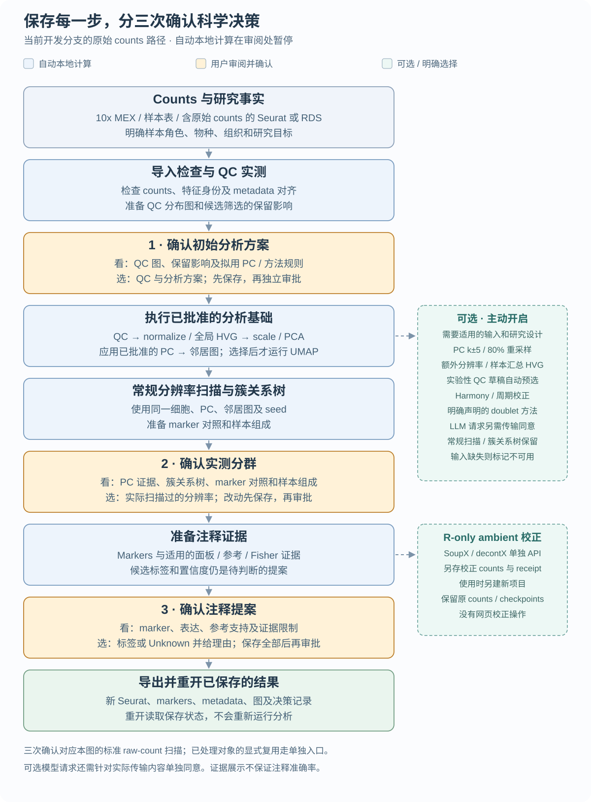

# scAgentKit

[English](README.md) · **简体中文**

scAgentKit 帮助研究者从单细胞 counts 和样本信息开始，完成 QC、基础分析、分群与注释复核。
保存的项目包含新的 Seurat 对象、marker 表、图和你的决策记录。

工作流将实测证据与可选模型建议汇集到研究者复核环节，并将每次获批决定保存在项目中。
[已有验证记录](benchmark/evaluation-v1/results/report.md)覆盖离线工作流执行；
单独的 [80 细胞模型检查](docs/MODEL_BUDGET.md)覆盖请求传输、响应校验与工作流运行。
生物学准确率、最优分析参数和人工作业时间节省尚未得到验证。

## 分析流程



[English diagram](docs/diagrams/project-analysis-flow.svg) · [中文流程图](docs/diagrams/project-analysis-flow.zh-CN.svg) · [流程图生成源](docs/diagrams/generate_project_flow.py)

当前源码工作流分别停在三次审批：分析方案、实测分群选择、注释提案。
按下方步骤操作；可选方法见[操作指南](docs/RESEARCHER_PROTOCOL_ZH.md)。

| 复核 1 | 复核 2 | 复核 3 |
| --- | --- | --- |
| [初始方案](#gate-strategy) | [实测分群](#gate-clustering) | [注释](#gate-annotation) |

## 安装

需要 R ≥ 4.2、Seurat ≥ 5，网页另需 Python ≥ 3.9。
网页资源已包含在 R 包中。
支持 **macOS 和 Linux**，**不支持 Windows**：本地服务和后台计算进程使用
[Unix `fcntl` 文件锁](https://docs.python.org/3/library/fcntl.html)。

当前推荐版本为 **0.8.1（实验性 prerelease）**。下载归档及校验文件，先验证原始字节：

```sh
curl -fL --retry 3 --connect-timeout 30 --max-time 1800 -o scAgentKit_0.8.1.tar.gz https://github.com/ChanghaoKan/scAgentKit/releases/download/v0.8.1/scAgentKit_0.8.1.tar.gz
curl -fL --retry 3 --connect-timeout 30 --max-time 1800 -o SHA256SUMS https://github.com/ChanghaoKan/scAgentKit/releases/download/v0.8.1/SHA256SUMS
shasum -a 256 -c SHA256SUMS  # macOS；Linux：sha256sum -c SHA256SUMS
```

校验通过后，在归档所在目录的新 R 会话中安装：

```r
options(timeout=max(1800, getOption("timeout", 60)))
lib <- path.expand("~/R/scagentkit-library")
dir.create(lib, recursive=TRUE, showWarnings=FALSE)
.libPaths(c(lib, .libPaths()))
if (!requireNamespace("remotes", quietly=TRUE))
  install.packages("remotes", repos="https://cloud.r-project.org")
remotes::install_local("scAgentKit_0.8.1.tar.gz", lib=lib,
  dependencies=c("Depends", "Imports"), upgrade="never", build=FALSE)
library(scAgentKit, lib.loc=lib)
stopifnot(as.character(packageVersion("scAgentKit")) == "0.8.1",
  identical(normalizePath(find.package("scAgentKit")),
    normalizePath(file.path(lib, "scAgentKit"))))
packageVersion("scAgentKit")
```

应从选定 library 读到版本 `0.8.1`。记录归档校验值、包版本和 `sessionInfo()`。
可选方法的依赖与版本要求见[运行环境支持](docs/LINUX_RUNTIME_SUPPORT.md)。
若 GitHub 依赖下载达到 API 配额，`remotes` 可使用已有的 `GITHUB_PAT`。
## 离线安装检查

在新项目中运行随包的小数据示例：

```r
source(system.file("examples", "simple-analysis.R", package="scAgentKit"))
result <- simple_analysis_after(tempfile("scagentkit-offline-"))
stopifnot(inherits(result, "Seurat"), ncol(result) > 0)
```

应得到含 80 个细胞、Unknown 标签的 Seurat 对象，然后再接入自己的输入。
[发布检查](docs/dev/archive/RELEASE_PLAN.md)保留安装与示例运行日志。

<a id="一个项目工作流"></a>

<a id="分析步骤"></a>

## 开发版快速开始

以下默认配置适用于开发分支，尚未包含在历史 0.8.1 发布归档中。
在 R 环境中设好所选 provider 的 API key，然后运行：

```r
library(scAgentKit)
sc_start("input.rds", "new-project",
  context=list(species="human", tissue="实际组织", research_goal="实际研究目的"),
  provider="deepseek")
```

交互式 R 会话中，一次确认汇总数据外发范围，然后在网页审阅三道审批的草稿。
采纳或保存草稿不等于批准。新建原始数据项目默认提供 QC/批次诊断证据，
并用 `react="auto"` 查证不确定注释；`react="off"` 可关闭查证。
费用和 token 事后记录，默认不设金额上限、不做预留。投递状态不确定时不自动重发；
没有 key 时明确退回手动模式。

非交互运行使用[完整模型示例](inst/examples/full-llm-workflow.R)，显式确认项目范围。
`review=list(allow_external=TRUE)` 保留逐次 payload 确认模式。
重开项目保留原配置；显式填写旧参数 `budget` 仍保留旧的封顶行为。
[ReAct 用户指南](docs/REACT_ZH.md) · [评估与重放](docs/REACT_EVALUATION_ZH.md)。

### 1. 选择输入，声明样本事实

选择新的项目目录。单个 10x MEX 目录需要样本 ID，并声明矩阵是 raw 还是 filtered：

```r
input <- "filtered_feature_bc_matrix"
project_dir <- "analysis"
context <- list(species="human", tissue="Actual tissue",
  research_goal="Actual study question")
service <- sc_start(input, project_dir, context=context,
  sample_id="S1", matrix_kind="filtered")
```

页面显示导入摘要和未审批方案。检查导入细胞、特征名称和样本信息，再进入第 2 步。

多个样本改用包含路径和研究事实的表：

```r
input <- data.frame(sample_id=c("S1", "S2"),
  path=c("counts/control", "counts/treated"),
  matrix_kind=c("filtered", "filtered"),
  donor=c("D1", "D2"), condition=c("control", "treated"))
service <- sc_start(input, project_dir, context=context)
```

样本 ID 必须唯一，各样本 Gene Expression 的 feature ID 集合须相同。
页面中的细胞 ID 为 `sample_id::barcode`。详细格式见[输入与 metadata 匹配](docs/TENX_INPUT.md)。

RDS 内可以是 raw counts 或 Seurat 对象；传入的是**文件路径**，
`sc_start()` 不接收内存中的 Seurat 对象：

```r
input <- "a.rds"
service <- sc_start(input, project_dir, context=context)
```

只用真实存在的 metadata 列声明已经核实的 sample、donor、capture、condition 角色；未知项留空。
counts/layer 检查及明确复用已处理对象的步骤见[操作指南](docs/RESEARCHER_PROTOCOL_ZH.md)。

### 2. 复核方案，再复核实测分群

<a id="gate-strategy"></a>

查看 QC 分布、样本对比、预计保留细胞及完整分析方案。
**Use candidate in local draft** 修改草稿；先 **Save**，阅读更新后的方案和证据，再 **Approve and continue**。
获批的本地分析运行后，页面停在实测分群复核。

<a id="gate-clustering"></a>

查看已计算 PC 曲线、簇关系树、marker 对照和样本组成，选择**实际扫描过的分辨率**。
保存修改、阅读更新后的审阅，再审批；随后进入注释工作表。
若选入的方法尚未 ready，修订选择或补足它列出的前提。
图的含义与 PC 规则见[方法附录](docs/SCIENTIFIC_METHODS_APPENDIX.md)。

### 3. 复核注释

查看 marker 及 DotPlot/FeaturePlot 证据。此版本为新项目离线加载固定 ACT 快照；
[快照来源与用法](docs/ACT_LOCAL_REFERENCE.md)，明确物种/组织并保留原 PMID。
缺失或零匹配会显示 unavailable，仍可按 marker/Unknown 人工复核。首轮模型注释仅看 marker；
其后最多一次另计预算的参考差异复核。CLID 使用固定版本的精确名称/同义词字典；歧义或未映射者保持缺失。

<a id="gate-annotation"></a>

打开工作表，阅读每簇 marker 和参考候选。每行填写标签或 **Unknown**、置信度、理由及提供的支持 marker。
在未编辑行选择参考候选，可复制其标签和引用；置信度与解释由你填写。
批量 Unknown 需输入理由，并保留已编辑行。

选择 **Save complete proposal**，通看各群，再 **Approve annotation and continue**。
页面应进入完成状态与结果页。请求及编辑控件见[注释辅助](docs/dev/ANNOTATION_ASSISTANCE.md)。

### 4. 取得结果

完成后使用相同的 R 包环境。下方绘图行要求分析方案中已运行 UMAP：

```r
result <- sc_result(project_dir)
Seurat::DimPlot(result, reduction="umap", group.by="sc_annotation", label=TRUE)
table(result$sc_annotation)
sc_open(project_dir)$view$output
```

项目还保存 marker 表、metadata、参数、图和审批记录。
注释完成前，`sc_result(project_dir, stage="analysis")` 可读取保存的暂定分析对象。
取得最终 Seurat 对象后，继续研究所需的下游分析。

### 5. 重开已保存项目

使用原包环境、原输入和原选项重复相应入口；省略 context，以读取已保存的研究事实：

```r
# For the single-directory example:
sc_start("filtered_feature_bc_matrix", project_dir,
  sample_id="S1", matrix_kind="filtered")
# For the sample-table example: sc_start(input, project_dir)
# For the RDS example: sc_start("a.rds", project_dir)
```

页面显示保存的阶段。不依赖原输入位置查看结果时，在 R 中用 `sc_open(project_dir)`，
只读网页用 `sc_run_open(project_dir)`。见[重开与错误处理](docs/RESEARCHER_PROTOCOL_ZH.md#11-输出恢复与可复现记录)。

## 局限

- 1.0 前任何版本都可能破坏兼容性，不保证弃用期，不支持跨版本恢复项目。
- 这套实验性流程执行你复核后的选择；运行完成不证明生物学准确率、QC/PC/分辨率最优或节省时间。
  Keep-all 是起始选择；`nCount >= 1` 只排除全零输入。小数据示例和 Unknown 标签用于检查软件流程。
- 80% PC 规则是项目经验规则；簇关系树的边表示共享细胞，不是谱系。
  参考重叠和定性置信度不是校准概率。缺失基因或评估不等于实测零值或检查完成。
  解释与分母见[方法附录](docs/SCIENTIFIC_METHODS_APPENDIX.md)。
- Raw MEX 导入保留所提供的 barcodes，不做 empty-droplet calling。
  FASTQ 处理及研究特定的轨迹、通讯、调控分析在本流程之外。
  可选诊断须输入适用并明确选择，见[操作指南](docs/RESEARCHER_PROTOCOL_ZH.md)。
- 保留每个项目的原输入、包构建和依赖环境。换版本时，以原输入另建项目并重新复核，旧证据另存。
  **不要修改项目校验值、审批记录或中间计算文件来强行恢复旧项目。**
  见 [API 变化](docs/dev/API_CONSOLIDATION.md)和[版本记录](NEWS.md)。

## 更多资料

- [English operator guide](docs/SCIENTIFIC_REVIEW_QUICKSTART.md) · [中文操作指南](docs/RESEARCHER_PROTOCOL_ZH.md)
- [10x 输入与样本表](docs/TENX_INPUT.md)
- [R 分析协议](docs/R_ANALYSIS_PROTOCOL.md)
- [分析方法](docs/dev/ANALYSIS_STRATEGY_SUPPORT.md) · [注释复核](docs/dev/ANNOTATION_REVIEW.md)
- [网页和远程服务器](workbench/README.md) · [文档索引](docs/README.md)

R 帮助：`?sc_start`、`?sc_analyze`、`help(package="scAgentKit")`。

[版本记录](NEWS.md) · [许可证](LICENSE.md)
